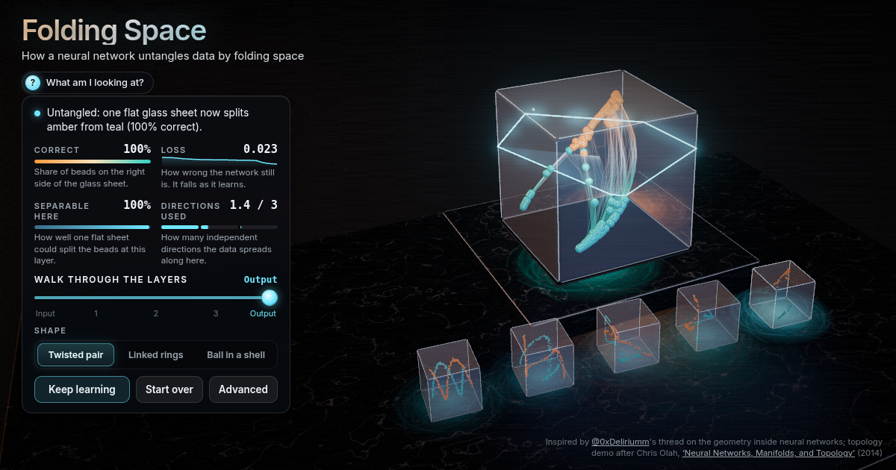

# Folding Space: a neural network untangling data

Watch a real neural network learn: two tangled strands of glass beads untwist as each layer bends and folds space, until one flat sheet splits them. Then see why linked rings need an extra dimension.



**Live demo:** https://interesting-x.scorpion-labs.com/folding-space/

Inspired by a bookmark from [@0xDeliriumm](https://x.com/0xDeliriumm/status/2107188738296041789).

Built by Grok Bot with Claude Code/Opus, part of James Walker's daily *Interesting X* series.

## Run locally

```bash
npm install
npm run dev      # then open the printed URL (served under /folding-space/)
npm run build    # static output in dist/
```

## Notes


A real neural network, trained live in the browser, untangles two strands of glass beads by bending, stretching and folding space. A clear acrylic cube shows where every bead sits after each layer; a silver lattice shows what that layer did to space itself; at the output a frosted glass sheet is the classifier's exact plane `w·h + b = 0`.

Inspired by [@0xDeliriumm's thread](https://x.com/0xDeliriumm/status/2107188738296041789) ("neural networks learn geometry, not rules"); the topology part follows Chris Olah, [Neural Networks, Manifolds, and Topology](https://colah.github.io/posts/2014-03-NN-Manifolds-Topology/) (2014).

```bash
npm run dev      # http://127.0.0.1:43148/folding-space/
```

## What's real

- `src/nn.ts` (pure, no DOM): seeded RNG, the three datasets, an MLP `3 → W×(depth−1) → 3 → 1` with tanh / ReLU / leaky ReLU, Xavier init, binary cross-entropy, full-batch Adam with global-norm gradient clipping, Jacobi eigen-decomposition, PCA with frame-to-frame sign/order alignment, a warm-started logistic-regression probe, the participation ratio `(Σλ)²/Σλ²`, the space grid, and `selfTest()`.
- `src/lab.ts` (pure): trains in small per-frame batches that follow wall time (60 steps/s, so it keeps learning at low fps), early-stops once 99.5 % of beads are right with loss < 0.06 (more steps would only saturate the layers further), and builds each layer's view. 3-neuron layers are shown directly in two honest stages (the linear part `W·h + b`, then the bend); wider layers show their top 3 principal directions. Each view is fitted to the cube (per-axis scale, limited anisotropy), and the sheet is transformed with the same fit, so it stays exact.
- Meters per layer: **Separable here** = linear-probe accuracy on that layer's activations; **Directions used** = participation ratio of the activation covariance spectrum (bars in Advanced).

## The topology result (measured, not asserted)

Linked rings are two solid tori (ring radius 0.5, tube radius 0.22) linked through each other's centre. Depth 4, tanh, Adam lr 0.03, 1800 full-batch steps, 10 seeds:

| neurons per layer | mean accuracy | range |
| --- | --- | --- |
| 3 | 93.8 % | 91–96 % (plateaus; more steps don't help) |
| 4 | 99.0 % | 8 of 10 seeds at 100 % |
| 6 | 100 % | all seeds |

A 3-wide tanh layer with invertible weights can only deform 3D space smoothly, so it cannot pass one ring through the other; it gets close only by crushing part of a ring flat. With a 4th direction it can lift one ring out. Ball-in-a-shell behaves the same way (3 neurons: 83–97 %, 6 neurons: 100 %). Thin rings were too easy (3 neurons reached 99 %), so the tubes are deliberately thick. `window.__foldSelfTest()` re-runs this check (seeds 1–3) in a few seconds.

## Test hooks

- `window.__foldInfo()` → `{renderer, shape, width, depth, layerView, step, loss, acc, probe[], dims[], frames, fps, …}`
- `window.__foldSelfTest()` → `{twisted:{acc}, ringsNarrow:{accs, mean}, ringsWide:{accs, mean}, probeRises, noNaN, pass}`
- `window.__foldAdvance(seconds)`: steps training and the auto-play without drawing.
- `window.__ixRecord`: deterministic stepped capture for `npm run record -- folding-space` (`record.json` uses `"capture": "frames"`).
- `?renderer=2d` forces the Canvas2D fallback; `?intro=0` hides the intro card; `?record=1` hides the intro card and gallery nav but keeps the live caption.

## License

MIT © 2026 James Walker
